<p align="center">
  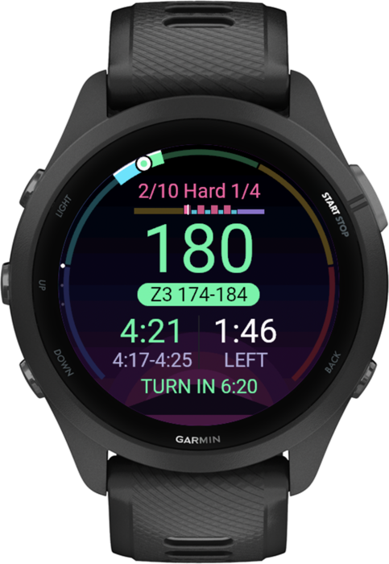
</p>

<h1 align="center">Trailhead</h1>

<p align="center">Marathon training on your Garmin.<br>
Tell it your race and the time you’ve got each week. It builds the plan, puts a coach on your watch, and changes the plan as you train.</p>

<p align="center"><a href="https://garmin.ttnt.cloud"><b>Try it at garmin.ttnt.cloud</b></a> · free · no account</p>

---

## On the watch

<table>
<tr>
<td align="center" width="25%">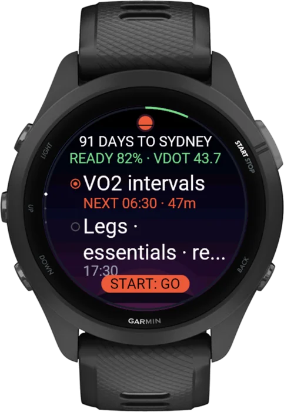<br><b>Today</b><br><sub>What to do, when, and for how long.</sub></td>
<td align="center" width="25%">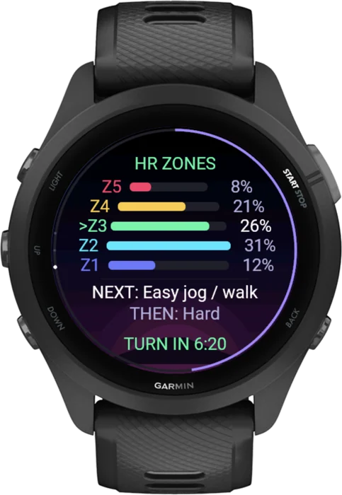<br><b>Heart-rate zones</b><br><sub>Target zone on the ring; it buzzes if you drift above it.</sub></td>
<td align="center" width="25%">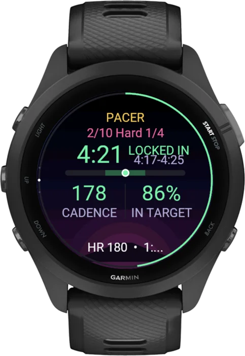<br><b>Pace targets</b><br><sub>A range per rep and a bar showing whether you’re in it.</sub></td>
<td align="center" width="25%">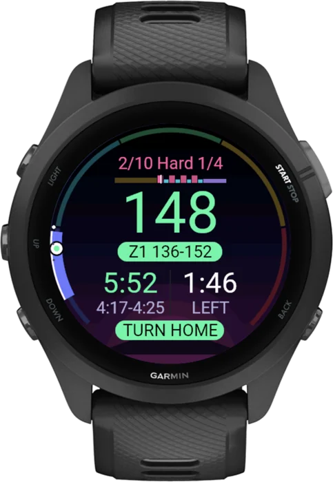<br><b>Turn home</b><br><sub>Tells you when to turn on out-and-backs so you finish where you started.</sub></td>
</tr>
<tr>
<td align="center">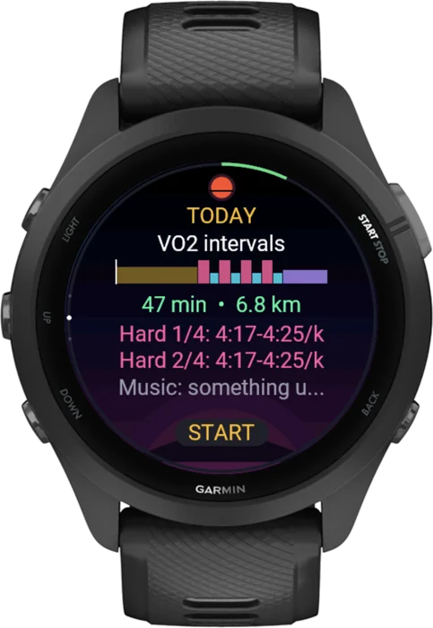<br><b>The whole session</b><br><sub>Every step laid out, with the bar across the top tracking progress.</sub></td>
<td align="center">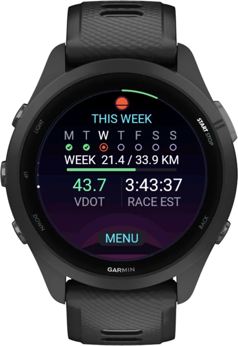<br><b>Your week</b><br><sub>Days done, distance so far, predicted finish.</sub></td>
<td align="center">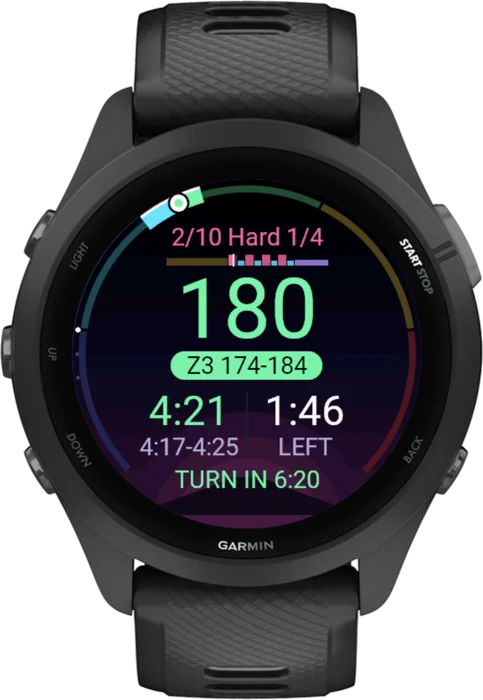<br><b>Guided workouts</b><br><sub>Warm-up, reps, recoveries and cool-down, step by step.</sub></td>
<td align="center">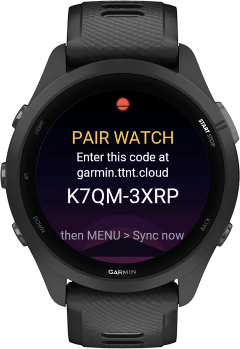<br><b>Pair once</b><br><sub>Type the code into the website and it syncs from then on.</sub></td>
</tr>
</table>

These are screenshots of the real app in the Connect IQ simulator, running a real plan.

## Watches

<p align="center">
  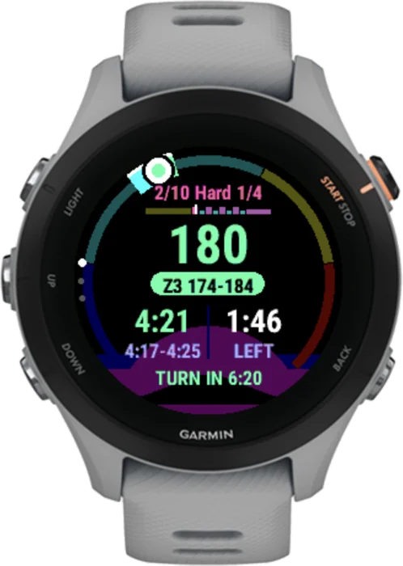
  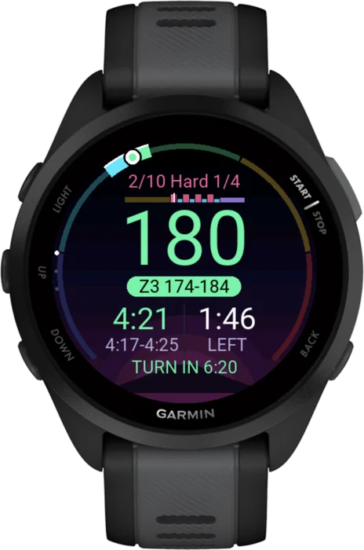
  
  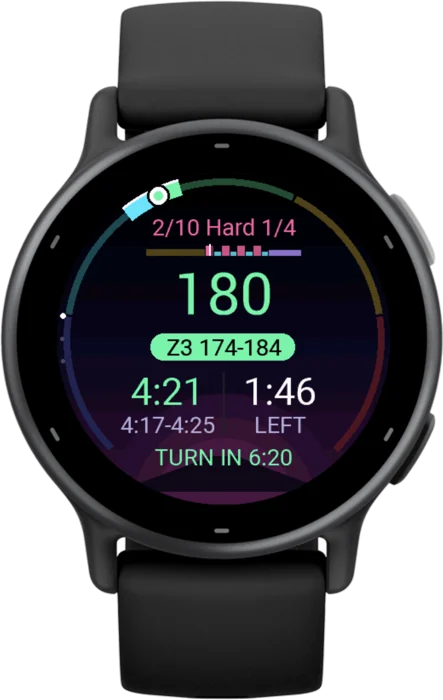
  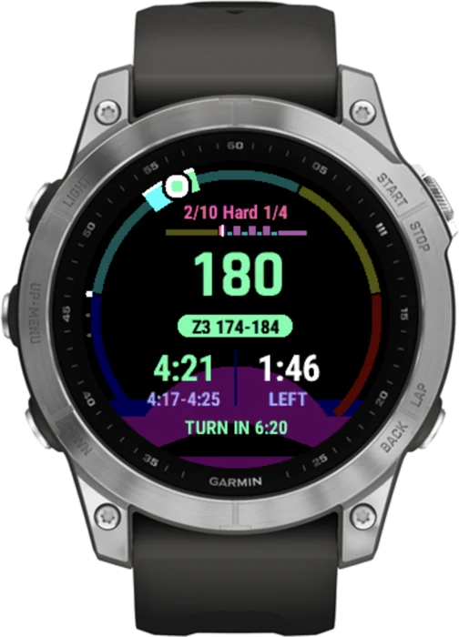
</p>

Forerunner 165 · 165 Music · 170 · 170 Music · 255 · 255S · 255 Music · 255S Music · 265 · 265S · 955 · 965 · 970<br>
vívoactive 5 · 6 · Venu 3 · 3S · fēnix 7

More models compile already. They get added once their layouts have been checked on screen.

## How it works

1. **Your race.** Date, goal, and roughly how much you run now. Optionally sign in to Garmin Connect so your recent runs are used.
2. **Your week.** How long you’ve got each day. The plan fits inside that.
3. **Your watch.** Plug it in and the app installs straight from the browser (Chrome or Edge; other browsers get a file to copy). Type the code it shows and you’re paired.

You get a private link to your plan. Open it every few days: it pulls in the runs your watch recorded, re-plans, and refreshes the watch for the next three weeks.

## How the plan is made

The plan comes from a simulation, not a template. Thousands of versions of you train to race day, each with different responses to training, off days, illnesses and injuries. The planner keeps the version of the plan with the best chance of your goal time without getting hurt.

- It models aerobic fitness, threshold, VO2 max, durability, running economy and race-specific fitness separately. Each one builds and fades at its own rate.
- It tracks fatigue per muscle group, running impact per week, and long-run spikes. Sessions that would overload something aren’t offered.
- Hard days are spaced out, long runs build steadily, recovery weeks come every fourth week, and the last weeks taper.
- Strength is short: one leg session a week by default.

Starting points are tuned in advance for common runner profiles. Your browser then fine-tunes for your exact calendar for two minutes before showing the plan.

## Privacy

- The plan is computed in your browser ([Pyodide](https://pyodide.org)), not on a server.
- There are no accounts. Your plan lives at an unguessable link. Only the browser that made it can change it.
- Garmin Connect can’t be reached from a browser directly, so sign-in goes through a small relay on the server. It passes your password to Garmin and keeps nothing. The sign-in token stays in your browser.
- The server stores your plan, the watch pairing code and the runs your watch uploads, so the watch can sync.

## Running your own

See [SELF-HOSTING.md](SELF-HOSTING.md). You need Python 3.12+, an HTTPS domain, and the Connect IQ SDK with your own developer key to build the watch app.

```
repo/
  engine/          the planner (Python + numpy): simulation, policy, workout builder
  web/             landing page, setup wizard, plan page; py/trailhead.py adapts the engine for the browser
  watch/           the Connect IQ app (Monkey C)
  server.py        static files + plan storage + watch sync + Garmin relay (standard library only)
  tools/           precook starting plans, build the watch app, tests, simulator renders
```

## Status

Marathon only for now. The model is tuned for the marathon distance.

Trailhead is not made by or affiliated with Garmin. Train sensibly, and see a doctor if you’re unsure whether you should be.

MIT licensed.
